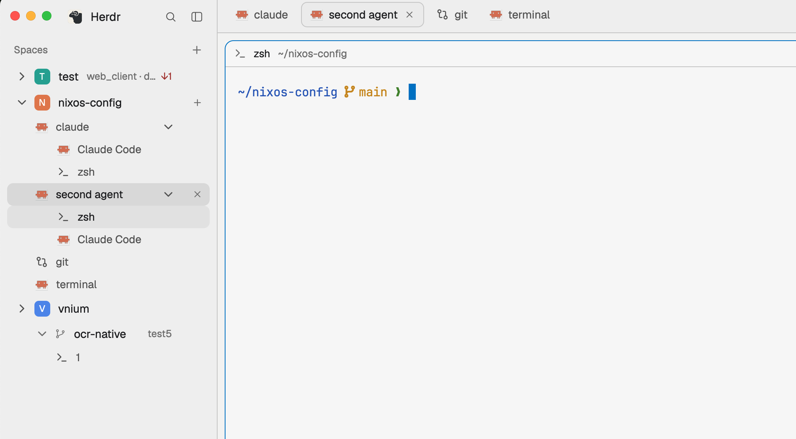

# herdr-nerd-tree

The [Herdr](https://herdr.dev) app's sidebar as a tree: every space with its
tabs right under it, the agents list kept separate — and **vim keys** to walk
it (`j`/`k`, `h`/`l`, `Enter`), the way NERDTree lets you walk a project in vim
without reaching for the mouse. `cmd-shift-e` to start.



## Why

Herdr's own window keeps tabs in the top bar, one space at a time: to see what
another space is running you switch to it. The terminal herdr lists them in
the sidebar, and we missed that.

[Nagell/herdr-nested-tabs](https://github.com/Nagell/herdr-nested-tabs) had the
right idea, and this started as a copy of it. Three things made us rewrite it:

- **It read your agent sessions in the background.** Every 5 seconds — even
  with its agent details switched off — it ran Python and shell scripts that
  read the tail of every Claude Code and Codex transcript, every agent's
  environment (`ps -E`) and open files (`lsof`), to print the model and
  context size under each agent. No network, but more than a sidebar should
  touch, and a steady cost in battery. That whole part is gone.
- **Half the row was empty.** A status column at the left of every row and a
  fold-arrow column before every tab's icon, both blank on most rows, pushed
  the names to the right. Status and the fold arrow now sit at the row's right
  end, in fixed slots so they line up, and a tab's icon sits right under its
  space's avatar.
- **It was mouse-only.** Now the sidebar takes the keyboard.

It also keeps the tab chips in the top bar (the fork hid them): tabs in both
places, `cmd-shift-t` to hide them there.

## Keys — vim-style, as in NERDTree

`cmd-shift-e` gives the sidebar the keyboard (as Explorer in VS Code), and so
does moving left out of the leftmost pane (`pane.go`, `cmd-alt-left` by
default). A ring marks the row under the cursor while it has the keyboard, and
the header shows `vim: j k h l ⏎ esc`.

| key | does |
|---|---|
| `j` / `k`, `↓` / `↑` | down / up through spaces, tabs and opened tabs' terminals |
| `g` / `G` | first / last row |
| `l`, `→` | on a space: show its tabs; on a tab with several terminals: list them |
| `h`, `←` | fold, or go up to the parent (terminal → tab → space) |
| `Enter` | go there; the keyboard returns to the terminal |
| `Space` | show it, keep the keyboard in the sidebar |
| `Esc`, `q` | back to the terminal, nothing selected |

Nothing in the sidebar closes or deletes from the keyboard. The mouse works as
in Herdr's own sidebar: click to switch, double-click a space to fold it or a
tab to rename it, drag to reorder, right-click for the menu, middle-click or
`×` to close a tab.

## What it runs

A sidebar mod in Herdr can run programs and fetch URLs with your permissions,
so here is all of it:

- `git status --porcelain=v2 --branch` and `git rev-parse` in each space's
  folder, for the branch and ahead/behind — read-only (`--no-optional-locks`),
  and only when its answer could have changed: the repo changed on disk (a
  file watch), a program or agent in that space finished, the space moved to
  another folder, or a minute passed while the window is in front.
- `hc machine ls` every 15 s, for the machine headers; `hc machine rm` + `add`
  only when you click Connect on a machine that was rebuilt.

No network, no scripts of its own, nothing written outside Herdr's own state.
The same calls Herdr's shipped sidebar makes.

## Install

Ask the agent in Herdr:

```
Read ~/.config/herdr-app/AGENTS.md, then add this layout: github.com/korolr/herdr-nerd-tree
```

or copy `layouts/` and `mods/` into `~/.config/herdr-app/`, merge `keys.json`
into yours, and switch to it with `cmd-shift-l`. Your own layout stays as it
was. Built from Herdr's `main` 0.1.13, used on 0.1.15.

## What changed from upstream

This is a modified copy (Apache-2.0, section 4b) of Herdr's shipped `main`
layout, `spaces` and `tabs` mods (herdr-app 0.1.13), by way of
Nagell/herdr-nested-tabs at `6b7b1db`. The changes:

- `spaces` → `mods/nerd-tree`: the agent details and the three scripts behind
  them (`claude-info.py`, `codex-info.py`, `subagents.sh`) removed; status and
  the tab fold arrow moved to the row's right end; the left status column and
  the empty fold-arrow column removed; keyboard navigation added
  (`"focusable": true`).
- `tabs` → `mods/nerd-tree-tabs`: renamed (its asset paths and its command
  with it). The layout passes `chips: true`, so the tab chips stay.
- `main` → `layouts/herdr-nerd-tree.json`: `spaces` and `tabs` replaced by the
  two mods above, nothing else.

## License

Apache-2.0, as Herdr and the fork it came through. See [LICENSE](LICENSE).
