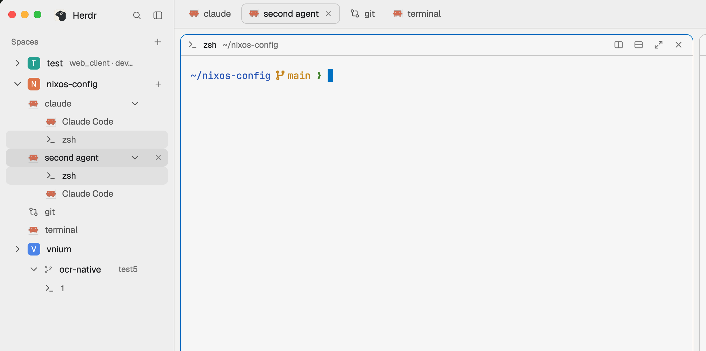

# herdr-nerd-tree

Herdr's main window with its spaces sidebar turned into a tree: each space
lists its tabs right under it, a tab with several terminals can list those, and
the agents list stays where it was below. The sidebar can take the keyboard and
be walked with vim keys. The top bar keeps Herdr's tab chips.

## What you see

Left to right: the sidebar (268 px, `chrome` background), then the work area.

- **Sidebar**, top to bottom: Herdr's brand block (46 px, `workspace-chrome`),
  the tree (`nerd-tree`) and the agents list (`agents`) sharing the height,
  Herdr's footer (69 px).
- **Tree header**, 31 px: "Spaces" in `dim` 11.5 px at left, a `+` (new space)
  at right. While the tree has the keyboard, `j k  h l  ⏎  esc` in 10.5 px sits
  before the `+`.
- **Space row**, 30 px (28 for a worktree), radius 8, 8 px left padding: a fold
  chevron (18 px box, 16 px Lucide chevron), 5 px, an 18 px rounded-5 avatar
  with the name's first letter in white on the space's color (a worktree shows
  a 13 px branch icon instead, one 23 px step further in), 9 px, the name, the
  git tail (repo and branch only where unusual, `↑n` in `ansi2`, `↓n` in
  `ansi1`), then the row's right end (below).
- **Tab row**, 26 px, radius 7, 12.5 px text: its 18 px program icon sits
  exactly under the space's avatar (31 px from the row's left edge), 7 px, the
  name (`Z` appended when zoomed), then the right end. A tab with several agents
  folded shows two overlapping 12 px icons and "N agents" in `dim` 11 px.
- **Terminal row** (an opened tab's terminals), 26 px: icon under the tab's
  name (25 px further in than the tab's icon), name, right end.
- **Right end of every row**, gap 4: the fold arrow (only on a tab with several
  terminals), a 10 px status slot, a 12 px action slot. The slots are always
  there, so statuses and `×` line up down the list.
- **Top bar**: Herdr's tab bar with its chips (`nerd-tree-tabs`, `chips: true`).
- **Status bar**: Herdr's own (`workspace-status`).

## How it behaves

- Status, in the status slot: working is a 10 px spinner in `working` turning
  once per 900 ms; blocked and done are 5 px dots in `blocked` / `done`; idle is
  empty. A tab shows the most urgent of itself and its terminals' agents
  (blocked, then working, then done); an opened tab leaves it to its terminal
  rows. A space shows it only when its tabs are folded.
- Action slot: `×` on the active or hovered tab closes it; `+` on the active or
  hovered space opens Herdr's new-tab menu for that space.
- The shown tab carries the `selected` background; with a space's tabs folded,
  the space does. Hover is `hover`.
- Mouse: click a space or tab to show it; double-click a space to fold its tabs,
  a tab to rename it; drag spaces (within a machine) and tabs (within a space)
  to reorder, an `accent` 2 px line marks the drop; right-click for Herdr's
  menu; middle-click a tab to close it; click a terminal row to focus it.
- Keyboard: `cmd-shift-e` (the `nerd-tree.focus` command), or `pane.go` left out
  of the leftmost pane, gives the tree the keyboard and puts the cursor on the
  shown tab (or its space when folded). The cursor row has a 1 px `accent`
  ring, shown only while the tree has the keyboard. `j`/`k`/`↓`/`↑` move,
  `g`/`G` first/last, `l`/`→` unfold a space or open a tab's terminals, `h`/`←`
  fold or go to the parent, `Enter` shows the row and gives the keyboard back
  (`pane.go` right; a terminal row is focused directly), `Space` shows it and
  keeps the keyboard, `Esc`/`q` give it back. The list scrolls to the cursor.
- `cmd-shift-t` (`nerd-tree-tabs.chips`) hides or shows the top bar's chips;
  the choice is remembered.
- Several machines: a header per machine (fold, `+` for a space there, a
  Connect link for a machine that was rebuilt). Narrow sidebar (under 160 px):
  one compact row per space, its number and a status glyph.

## Built from

- `layouts/herdr-nerd-tree.json`: Herdr's `main` (0.1.13) with the `spaces`
  block's mod set to `nerd-tree` and the `tabs` block's to `nerd-tree-tabs`
  (props `{ "chips": true }`). Nothing else differs.
- `mods/nerd-tree`: a clone of the shipped `spaces` mod. `mod.json` has
  `"focusable": true`. It reads `spaces()`, `panes()`, `agents()`,
  `machines()`, `layout()`, `shared("space.colors")`; runs `space.select`,
  `space.move`, `space.new`, `tab.select`, `tab.move`, `tab.close`,
  `tab.rename`, `pane.focus`, `pane.go`; opens the `menu` and `new-menu`
  overlays. Programs: `git status --porcelain=v2 --branch` and `git rev-parse`
  in each space's folder, only when the answer could have changed (a
  `watchFolder` on local repos, a finished program, a moved space, a minute
  with the window in front); `hc machine ls` every 15 s; `hc machine rm`/`add`
  from Connect only. Keyboard: a `FocusHandle` on the root
  (`track_focus`, `on_key_down`), `nextCommand()` "focus", a `ScrollHandle`
  on the list and `scroll_to_item`. Rows the cursor walks are recorded while
  rendering, in screen order, with their index among the list's children.
- `mods/nerd-tree-tabs`: a clone of the shipped `tabs` mod, renamed, with the
  `chips` prop and command; its window-button SVGs.
- `keys.json`: `cmd-shift-e` → `nerd-tree.focus`, `cmd-shift-t` →
  `nerd-tree-tabs.chips`.

## Watch out

- Do not read agents' session files, environments or open files for the
  sidebar, on a timer or at all. That is what this layout was made to drop.
- The status and action slots must exist on every row, empty or not, or the
  right ends stop lining up.
- `is_focused()` is read once per render and decides the ring; if the ring
  shows a frame late after `cmd-shift-e`, that is where to look.
- `herdr-app check` writes `gpui-kit.d.ts` and `jsconfig.json` into each mod
  folder; they are generated, not part of the build.
- Names: `nerd-tree` and `nerd-tree-tabs` must not collide with Herdr's
  shipped mods or with Nagell/herdr-nested-tabs (`nested-tabs`, `tabs-bar`),
  which people may have installed alongside.
- Built on 0.1.13 copies; used on 0.1.15. A newer Herdr's `spaces`/`tabs`
  changes are not picked up by these clones.

## Done when

- Every space lists its tabs; each tab's icon sits under its space's avatar.
- An agent working shows a spinner at the row's right end, in line with the
  other rows' `×`; a blocked or finished one shows a dot there.
- `cmd-shift-e` puts a ring on the shown tab; `j`/`k` move it; `Enter` shows
  that tab and typing goes to its terminal again; `Esc` returns without
  changing anything.
- `l` on a folded space unfolds it; `h` on a tab moves to its space; `h` on an
  open space folds it.
- A tab with two terminals has a fold arrow at its right end; opening it lists
  both, and clicking one focuses that pane.
- The top bar shows tab chips; `cmd-shift-t` hides them and the choice survives
  a restart.
- `herdr-app check` passes for both mods.
